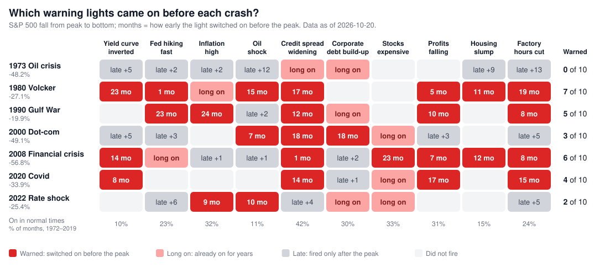

# Economic Crisis Signals

**Which warning lights flashed before 7 major US stock-market crashes, 1973–2022 — and which are on today.**

**Website: <https://leeshien.github.io/economic_crisis_signals/>**



*Each row is a crash, each column a warning light. Red = switched on before the market peak (number =
months early). Pink = already on for years. Grey = fired only after the peak. Blank = did not fire.
The image is rebuilt from the data every week.*

## What this is

Every major US stock-market crash has a story: an oil shock, a bubble, a housing bust, a pandemic.
But did the economy show warning signs beforehand? This site tracks 10 economic indicators across 7
crashes (1973, 1980, 1990, 2000, 2008, 2020, 2022). For each crash it shows:

- **What caused it** — a five-step chain from root cause to outcome.
- **Which warning lights came on** — each light is switched on by a simple, published rule, the same
  for every crash (for example: *the 10-year Treasury yield falls below the 3-month bill yield*).
- **When they came on** — a timeline marking each light as an early warning, long on, too late, or
  never fired.

A **Lights today** page applies the same rules to the latest data.

## What the history shows

- **Some crashes were clearly signalled, some were not.** In 1980, 7 of the 10 lights came on before
  the peak; in 1973, none did — the famous oil embargo came nine months after the market had peaked.
- **Some crashes come from outside the economy.** In 2020 several lights showed a softening economy,
  but nothing could forecast a pandemic.
- **The valuation light is a poor timer.** Stocks were expensive for years before 2000 and before 2020.
- **Every light gives false alarms.** The bottom row of the scoreboard shows how often each light was
  on in ordinary times (1972–2019). A light that is often on tells you less.

## The 10 warning lights

| Group | Light | Switches on when |
|---|---|---|
| Rates | Yield curve inverted | 10-year Treasury yield is below the 3-month yield |
| Rates | Fed hiking fast | Fed funds rate is at least 1.5 points higher than 18 months earlier |
| Prices | Inflation high | Consumer prices are more than 4% higher than a year earlier |
| Prices | Oil shock | Oil price is more than 50% higher than a year earlier |
| Credit | Credit spread widening | Baa corporate bond spread is at least 0.5 points above its 2-year low |
| Credit | Corporate debt build-up | Non-financial corporate debt is at least 3 points of GDP higher than 3 years earlier |
| Markets | Stocks expensive | Shiller CAPE ratio is above 25 |
| Economy | Profits falling | After-tax corporate profits are lower than a year earlier |
| Economy | Housing slump | Housing starts (3-month average) are at least 20% lower than a year earlier |
| Economy | Factory hours cut | Average factory work week is at least 0.5 hours below its 12-month high |

A light **warned** of a crash if it switched on in the 24 months before the market peak and was still
on at some point in the final 12 months. The site's *Method* page explains the full rule, including
how back-to-back crashes (2020 → 2022) are handled.

## Data

- **FRED** (Federal Reserve Bank of St. Louis): interest rates, prices, credit, debt, profits,
  housing, jobs, recession dates, recent S&P 500.
- **Robert Shiller**: long-run S&P 500 and CAPE. Shiller's file has not been updated since
  September 2023, so the valuation light shows *no current data* on the Lights today page.
- Crash peak and bottom dates were checked against daily S&P 500 closes.

No API keys are needed. A GitHub Action downloads fresh data every Monday, runs the tests, rebuilds
the site and publishes it.

> **For education only — not investment advice.** Past warning signs do not predict future crashes.

---

## For developers

```bash
pip install -r requirements.txt           # Python 3.12
python -m pipeline.fetch                  # download FRED + Shiller data into data/raw/
python -m pytest -q                       # unit tests + frozen reference scoreboard
python -m web.build                       # writes dist/ and docs/scoreboard.svg
python tools/print_scoreboard.py          # the scoreboard as text
```

Open `dist/index.html` in a browser to view the site.

If you change a rule, threshold or crash date, the build stops because the scoreboard no longer
matches `tests/reference/scoreboard.json`. Review the change, then run
`python -m web.build --update-reference`.

| Path | What |
|---|---|
| `config/crises.py` | 7 crashes: peak/bottom closes, cause chain, notes, lesson, sources |
| `config/signals.py` | 10 signals + Sahm rule: inputs, threshold, plain-English text |
| `pipeline/fetch.py` | downloads raw data (keeps old files if a source fails) |
| `pipeline/load.py` | raw CSV → monthly series (quarterly dated at quarter end) |
| `pipeline/rules.py` | metric + threshold → light on/off per month |
| `pipeline/score.py` | early / long on / late / did not fire, lead times, false-alarm rate |
| `pipeline/report.py` | assembles everything the pages show |
| `web/` | Jinja2 templates, server-side SVG charts, CSS → `dist/` |
| `docs/scoreboard.svg` | scoreboard image for this README (written by the build) |
| `.github/workflows/refresh.yml` | weekly fetch → test → build → GitHub Pages |

Design notes: `docs/superpowers/specs/2026-10-20-macro-pulse-design.md`.
